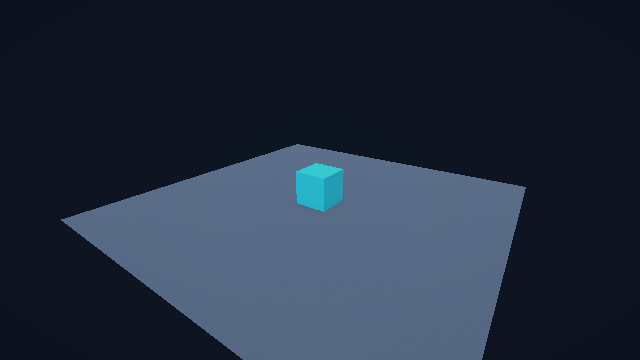

# ASCL 0.3.0 · OEvent 接入验证

2026-10-21（Asia/Tokyo）。OEvent 已替换 EventScope，技术检查通过。本记录对应目标
[ASCL-S0-005](../Goals/ASCL-S0-005.md)，不表示其他阶段目标完成，也不替代用户的人工反馈。

## 版本与来源

- 旧版完整基线：`3dcaaa374518fe3543472c1e900d6260623fbbe8`，已推送
  `codex/legacy-pre-oevent-20261021`，`git ls-remote` 核对同一哈希。
- 实施分支：`codex/unity-6000.3.23f1-urp3d`，保留既有 origin/upstream；未合并 main。
- OEvent 来源：本机 StaticEventSystem，提交 `066c1e442ee2e5a93f399ecf74f1b54d9c29447c`。
  [原始文件 SHA-256 清单](../WorkLogs/OEvent-0.3.0/source-manifest.json)记录五个核心文件。
  接入结束时复核五项一致；来源工程未修改。来源中其他既有未提交内容不属于本次来源代码。
- 包版本：`0.3.0`。这是事件 API 的破坏性变更，详见
  [迁移说明](../../Packages/com.operationgamestudio.ascl/MIGRATION-0.3.0.md)。
- [本地 HTML 审查页](../WorkLogs/OEvent-0.3.0/review.html)包含编号判断项、真实实现差异、原始证据及结论导出。

## 实施内容与语义

`ASCL.Core` 包含 OEvent 特性、四类 MethodObject 和全局管理器；保留原命名空间、Run、
Register/Unregister、初始化/清理与四种广播入口。内部返回/无返回管理器统一为可复用通道，
移除旧 KSingleton、LogHelper、UnityEngine 依赖，以 ILogSink 记录错误。EventScope 及其
订阅 token、委托入口、唯一查询 API 已删除，Entity.Track 的通用资源释放保留。

优先级从小到大，同优先级按注册顺序；自动候选按程序集和类型稳定名称排序。每个具体处理器
类型只有一个注册对象。重复注册不覆盖原实例，其他实例不能代替原实例退订。事件类型、结果
类型和同步/异步模式共同确定通道。

无返回事件顺序执行全部处理器，异步逐个等待，异常向上传播。有返回事件在首个正常返回时
结束，包括 null；普通异常记录后尝试下一项，无结果返回 null，取消异常直接向上传播。
广播捕获候选数组；期间新增只对之后的广播（包括嵌套广播）可见，退订立即生效。

初始化可自动扫描或显式装配，重复初始化不重复注册，失败清理部分注册并报告类型/加载原因。
自动扫描只检查已加载且引用图可达特性程序集的非动态程序集，避免误扫描独立编译工具；
相关程序集加载不完整时仍明确失败。需要先加载处理器及基类程序集，或显式传入类型。

`ASCL.Unity` 在 SubsystemRegistration 重置、BeforeSceneLoad 初始化、退出时清理。
单个 World/场景销毁不清空全局注册。处理器不保存场景对象，目标通过事件参数传递。
Dispose 使旧代次失效；已进入的异步 Run 完成后广播取消，不继续后续处理器，也不进入新代次。
管理器不能强制终止已进入的 Run。

## 环境与复现命令

Windows 11 x64，.NET SDK `8.0.301`，Unity `6000.3.23f1 (09d2ecc7fb28)`，URP `17.3.0`。
Unity 使用 `U:\DevProject` 短路径映射到同一仓库文件。EditMode 使用 `-nographics`，
PlayMode 使用 Windows D3D11；没有构建移动端 Player。

```powershell
dotnet build Tools/ASCL.SourceGen/ASCL.SourceGen.csproj -c Release --no-restore --nologo
dotnet build DotNet/ASCL.Runtime/ASCL.Runtime.csproj -c Release --no-restore --nologo
dotnet test ASCL.sln -c Release --no-restore --nologo --logger 'trx;LogFileName=dotnet.trx' --results-directory Docs/WorkLogs/OEvent-0.3.0
./Tools/Validate-Unity.ps1 -UnityEditor 'C:\soft\UnityEditors\6000.3.23f1\Editor\Unity.exe'
# 补充逐次 Power/Buff/刷新计数断言后，重跑受影响的 PlayMode：
./Tools/Validate-Unity.ps1 -UnityEditor 'C:\soft\UnityEditors\6000.3.23f1\Editor\Unity.exe' -TestPlatform PlayMode
# 从 Tools/KnowledgeSite 目录运行：
pnpm roadmap:validate
```

## 检查项与证据

| 检查项 | 实际结果 | 证据与边界 |
| --- | --- | --- |
| .NET 完整回归 | 56/56 通过 | [dotnet.trx](../WorkLogs/OEvent-0.3.0/dotnet.trx)，.NET 8 执行；含既有实体/数值/战斗/生命周期测试 |
| 双目标编译 | netstandard2.1 / net8.0 通过 | [构建输出](../WorkLogs/OEvent-0.3.0/dotnet-build.txt)，零警告/错误；不是 netstandard 独立运行测试 |
| Unity EditMode | 51/51 通过 | [unity-editmode.xml](../WorkLogs/OEvent-0.3.0/unity-editmode.xml)，包括共享 OEvent 测试及两次真实进入/退出 Play Mode |
| Unity PlayMode | 5/5 通过 | [unity-playmode.xml](../WorkLogs/OEvent-0.3.0/unity-playmode.xml)，场景、Demo、渲染及原有 UI 回归 |
| 四类事件/自动发现/顺序/异常/返回值 | 通过 | OEventTests；返回 null、失败 fallback、取消不 fallback、双结果类型及同步/异步分离 |
| 重复注册/错误实例退订/重入/订阅变化 | 通过 | OEventTests；嵌套广播、等待期间退订与新增、返回值通道候选变化 |
| 初始化失败及重复初始化/清理 | 通过 | OEventTests；构造、注册、无默认构造、泛型/非法类型失败清理及恢复 |
| 在途广播清理再初始化 | 通过 | SuspendedOldGenerationIsCancelledAfterCurrentHandlerFinishes 两种通道；释放当前 Run 后取消 |
| Domain Reload 关闭的重复运行 | 通过 | RepeatedPlayWithoutDomainReloadRebuildsOneGlobalRegistration；两次启动仅一份注册，退出后计数为零 |
| 场景重载/旧目标事件 | 通过 | SceneReloadKeepsGlobalRegistrationAndIgnoresDestroyedTarget；处理器字段检查无场景状态，新场景只刷新自身 |
| Boost Demo 实际事件路径 | 通过 | SceneTicksWorldAndAppliesSkillBuffToPresentation；Power `10→12→14→16→16`，Buff `0→1→2→3→3`，刷新次数 `1→2→3→4→5`；按钮仍用原回调 |
| 原呈现与两个质量档 | 通过 | 原场景、材质和布局未改；最终立方体高度1.6、中心Y0.8、文字含16。以下两图是相机 RenderTexture，不包含 Overlay UI |
| 路线图 | 通过 | 新增 D01-C07 / ASCL-S0-005，S0 退出目标增加依赖；最终结果见 [roadmap-validation.txt](../WorkLogs/OEvent-0.3.0/roadmap-validation.txt) |
| 本地审查页 | 通过 | [browser-check.json](../WorkLogs/OEvent-0.3.0/browser-check.json)；Edge 本地文件打开、依赖、反馈导出及截图检查。技术检查不等于人工结论 |




## 失败与修复保留

1. Unity 的 NUnit 分支不提供 NonParallelizable，初次编译失败；仅 .NET 使用该特性，Unity
   测试保持串行。[首轮诊断](../WorkLogs/OEvent-0.3.0/unity-first-attempt.txt)。
2. 第二轮 EditMode 48/51：扫描已加载 ASCL.SourceGen 时缺少编译期 Microsoft.CodeAnalysis，
   同时异步取消实际为 TaskCanceledException 而测试错误要求精确基类。
   [失败 XML](../WorkLogs/OEvent-0.3.0/unity-second-attempt.xml)。
   修复为按已加载引用图发现处理器程序集，并接受 OperationCanceledException 派生类；最终51/51。
3. Unity 日志仍含既有代码的 CS8632 可空注解警告，未将其描述为零警告构建。

## 明确限制

- 全局单例，单个逻辑执行线程；没有多世界独立事件域，也没有新增并发线程安全保证。
- 主动释放/取消处理器内部工作由其所有者负责，Dispose 不强停在途 Run。
- 反射扫描可用不代表 IL2CPP stripping/AOT 验证通过；IL2CPP、移动端 Player、外部消费项目迁移待各自任务验证。
- Mobile 图片只代表 Windows Editor 的 Mobile 质量配置，不是手机实机证据。
- 本次没有新的零分配/性能基准认证，也没有人工视觉验收结论；场景引用检查覆盖已实现 Demo 处理器及运行流程，不替任意未来业务处理器保证无泄漏。
